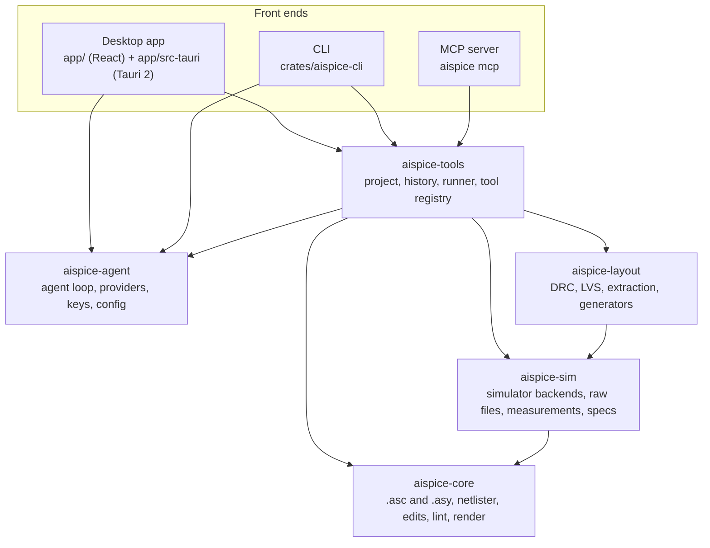

# Architecture

aispice is a Rust workspace with one engine and three front ends. The desktop app, the command line and the MCP server all call the same tool registry, so a tool behaves the same everywhere and is tested once.

## Crates

### aispice-core

Pure computation over files: no processes and no network.

| Module | What it does |
|---|---|
| `encoding` | Reads and writes LTspice's encodings (Latin-1, UTF-8, UTF-16LE with or without a byte order mark) and keeps the original on save |
| `schematic` | Lossless `.asc` parser and writer. A file that is read and written unchanged comes back byte for byte |
| `symbol` | `.asy` parser, a built-in library of the common parts, and lookup through the project folder, extra folders and an LTspice installation |
| `geometry` | Grid points, LTspice's rotate-then-mirror orientations, segment indexing for connectivity |
| `netlist` | Schematic to SPICE netlist, following LTspice's own netlister: net naming, pin order, model cards, hierarchy. `policy` checks every netlist before a simulator sees it |
| `pdk` | The devices of the PDKs aispice knows (IHP SG13G2): subcircuit, corner library, pins, default sizes, symbol |
| `edit` | Typed edit operations (add, remove, move, rotate, set value or attribute, connect pins, label nets, directives) with automatic placement and wire routing |
| `layout` | Netlist to schematic: places parts by circuit conventions (signal left to right, ground down, rails up, transistor stacks in columns), routes wires on a grid, tries several strategies and keeps the best one that netlists back to the input |
| `lint` | Rule checks for what makes a simulation fail or mislead: no ground, floating pins, nets with no DC path, shorted parts and sources, sources in parallel, missing values or analysis, duplicate names; readability checks (off-grid, overlapping parts) as information |
| `summary`, `diff` | What the agent reads: parts with the net on every pin, and a semantic diff after an edit |
| `render` | SVG and PNG drawings of schematics |
| `macropkg` | Macro packages shared with ChipLeap (`macro/v1`, [macro-package.md](macro-package.md)): the manifest, a small interpreter of its JSON schema, readers for GDS, LEF, liberty, Verilog and SPICE, the validator and evidence writing. ChipLeap's Python validator runs the same rules with the same messages |

The netlister is checked against LTspice itself: `crates/aispice-sim/tests/golden_netlist.rs` compares aispice's netlist with LTspice's `-netlist` output for every test schematic, and a larger corpus run matched 660 of 660 files.

### aispice-sim

Running simulators and reading what they return.

| Module | What it does |
|---|---|
| `backend` | ngspice, Xyce, LTspice (native or under Wine) and Spectre (over SSH). Each run is an argument vector in a private temporary folder, with a timeout and capped output |
| `dialect` | Translates the LTspice-flavoured netlist for the simulator in use |
| `raw`, `log`, `dataset` | Binary and ASCII raw files, logs and `.meas` results, as one dataset type |
| `expr` | Expressions over vectors (`V(out)/V(in)`, `db()`, `ph()`) |
| `measure` | Named measurements: values, extremes, rise and fall time, overshoot, settling, crossings, gain, bandwidth, unity-gain frequency, phase and gain margin, peaking, the Q of a second-order lowpass, noise densities and integrated noise, PSRR and CMRR |
| `noise` | Noise results in one shape from every simulator (Xyce's `_noise.dat` included), and integration of a noise density over a band |
| `stimulus` | The derived AC run PSRR and CMRR compare with: every AC stimulus removed and `AC 1` on one source |
| `spec` | Spec tables: a measurement plus limits, evaluated to pass or fail with a margin |
| `corner` | Corner sets (process sections of corner libraries, temperatures, supplies) as netlist variants, and the worst case per spec |
| `library` | Corner library files read through the netlist policy (its line reader and resolver, size and count limits), and inlining of library sections for simulators that cannot select them |
| `sweep`, `montecarlo`, `optimize` | Parameter sweeps, tolerance and mismatch analysis with yield, and sizing parameters within bounds to meet specs, also in the worst case over corners |
| `pdk` | An installed PDK: checking its folder, its compiled models, the model header a netlist needs and the git commit it is at |
| `gmid` | gm/Id lookup tables for a PDK's transistors, built on ngspice and cached, and sizing from them checked by simulation |
| `plot` | SVG plots of waveforms |

### aispice-layout

Analog layout on a PDK's own decks and pcells. Every external program runs from an argument vector in a private folder that is also its `HOME`, with scripts that are aispice's own (embedded in the binary) and values passed as data: `-rd name=value` for KLayout, environment variables for Magic.

| Module | What it does |
|---|---|
| `tools` | Finding KLayout and Magic, run folders, and the checks every name and path passes before it reaches a program |
| `gds` | A small GDSII reader: cells, top cells, layers and labels, with limits on size and nesting |
| `drc` | IHP's KLayout decks (main, extra, antenna, density) run directly with the switches `run_drc.py` sets, and their report databases read into rules, layers and boxes |
| `lvs` | The CDL netlist IHP's LVS deck reads, written from a circuit (or the devices a layout holds, plus its dummies); the deck run, and its result read through KLayout's own API |
| `extract` | Magic with IHP's tech file: devices, coupling capacitance and resistor networks, and the post-layout netlist that puts the extracted cell in place of the schematic's devices |
| `generator` | Templates (mirror, pair, OTA, two-stage op-amp, comparator) that check a circuit's topology and plan rows of matched two-finger units with dummies and guard rings, MIM capacitors brought down to the routing, a router of Metal3 tracks and Metal4 spines, and the KLayout script that draws a plan with IHP's pcells |
| `render` | Layout pictures with KLayout's batch `LayoutView` |

### aispice-agent

The language model side. It knows nothing about circuits.

| Module | What it does |
|---|---|
| `provider` | Streaming clients for Anthropic's Messages API and OpenAI-compatible APIs (OpenAI, Gemini, OpenRouter, Ollama, custom endpoints), mapped onto one message type. Retries, size limits, and redaction of keys in errors |
| `agent` | The tool calling loop: stream a reply, run the tools it asks for, feed the results back, stop at a step limit or when cancelled |
| `tool` | The `Tool` trait and the registry, shared by the agent and the MCP server |
| `keys` | API keys in the OS keychain, with a private file as fallback and environment variables first |
| `config` | `config.toml` |
| `testing` | A scripted provider for tests |

### aispice-tools

Where circuits meet the agent.

| Module | What it does |
|---|---|
| `project` | The open folder. Every path is resolved inside it and refused if it escapes, including through symbolic links. Writes are atomic, and every save records a snapshot for undo |
| `runner` | Picks a simulator, netlists the circuit (with the PDK's model header in a PDK project), runs it, keeps recent results |
| `pdk` | The user's PDK registry (`pdks.toml`) and a project's `aispice.toml` |
| `layout` | The layout flow on a project: opening its GDS files, run folders, hints from DRC and LVS failures, and the post-layout netlist check_specs simulates |
| `workspace` | What all tools share: the project, the runner, and hooks a front end sets (approve an edit first, reload LTspice after a save) |
| `tools` | The tools themselves. `aispice docs tools` prints the full reference |
| `templates` | The verified reference circuits behind the `templates` tool, embedded in the binary |
| `eval` | The design task runner and judge behind `aispice eval` |
| `prompt` | The system prompt |
| `setup` | Builds a workspace and runner from the config file |

### aispice (CLI)

`crates/aispice-cli`, the `aispice` binary: `chat`, `sim`, `check`, `netlist`, `lint`, `show`, `render`, `draw`, `eval`, `macro`, `mcp`, `pdk`, `gmid`, `layout`, `drc`, `lvs`, `extract`, `doctor`, `keys`, `models` and `docs`. The MCP server uses the `rmcp` crate over stdio.

### Desktop app

`app/` is a React interface built with Vite; `app/src-tauri` is the Tauri 2 shell. The shell has no circuit logic of its own: its commands call `aispice-tools`, and the agent streams events to the interface over a Tauri channel. The interface types in `app/src/ipc/types.ts` are the contract between the two. `app/src/ipc/mock.ts` implements the same contract in the browser, which is what the interface tests and screenshots run against.

## How a request flows

1. The user asks for a change in chat. The front end builds the system prompt (project, open circuit, simulators found) and starts the agent with the tool registry.
2. The model reads the circuit with `read_schematic`, which returns parts, the net on each pin and the directives, so it never has to reason about coordinates.
3. It calls `edit_schematic` with typed operations such as "set R1 to 2.2k" or "connect R2.A to out". aispice places parts on the grid and routes wires, recomputing connectivity for every candidate route so a wire joins only the pins it was asked to join.
4. If the user chose "ask before applying", the front end shows the diff and waits. Otherwise the edit is saved at once, with a snapshot for undo, and LTspice is shown the new file.
5. The model proves the change with `simulate`, `measure` and `check_specs`, and can size parts with `optimize` or check robustness with `monte_carlo` and corner sets.
6. Every tool returns text for the model and structured data for the interface (diffs, waveforms, spec tables), which the chat shows as cards.

## Security model

Circuit files, simulator logs and tool output are data, not instructions. The design limits what any of them can do:

- **Confinement.** Tools work inside the project folder. Paths are canonicalised and anything outside the folder, or inside `.aispice/`, is refused.
- **No shell.** Every process is started with an argument vector. The one remote shell command, for Spectre, is built from the user's configuration and values aispice generated and checked.
- **Netlist policy.** Before a simulator runs, the netlist and everything it includes are checked against an allowlist of dot-commands. Control blocks, shell escapes, and includes outside the project are refused. The check reads a deck the way ngspice and Xyce do (both of their rules for which line a `+` continues), accepts include lines in one form both read alike, and the deck's own include lines are rewritten to name the checked file, so the simulator opens exactly what was approved; a test runs odd spellings through both simulators against a decoy outside the project.
- **Compiled models.** A PDK's transistor models are compiled code (ngspice OSDI files, Xyce plugins). A netlist can never load one: `pre_osdi`, `osdi`, `codemodel` and includes of compiled libraries are refused everywhere. aispice loads them itself, outside the deck (in the start-up file it writes into the private run folder, or with Xyce's `-plugin`), and only from a PDK folder the user registered with `aispice pdk add`, after checking each resolved path is inside that folder. A project can only name a registered PDK in `aispice.toml`, never a path, and the agent cannot register one. `aispice.toml` is project content: it is read only as a regular file, never through a link, and its errors give a line and column, never its text. Registered folders are include roots whose files get every policy rule except the path heuristic their expressions (`w/ng`) would trip.
- **Layout programs.** KLayout and Magic run only scripts aispice ships, written into a private run folder that is also their `HOME` and `TMPDIR`, so no start-up file of the user's or a project's is read and no temporary file is shared with another run (IHP's pcell library writes fixed-name modules there and executes them). Paths and names reach them as data (`-rd` values, environment variables), never as script text: cell, net and label names must match `[A-Za-z0-9_$.<>-]`, paths must be absolute without control characters, and each script checks them again. A project's GDS files must lie inside the project and are read first by aispice's own bounded reader (256 MiB, 64 levels of nesting); report databases, LVS results and extracted netlists are read with size and nesting limits, and each reader is fuzzed with random and mutated input.
- **Approval.** Every tool that writes goes through one approval hook, so "ask before applying" covers edits, spec files, optimiser results and undo.
- **Keys.** API keys stay in the keychain and are never logged, printed or included in errors.
- **Desktop.** A strict content security policy, minimal Tauri capabilities, and SVG sanitising in the interface. Chat sessions are stored in the user's data folder, never in a project, so a cloned repository cannot plant a conversation.

See [SECURITY.md](../SECURITY.md) to report a problem.

## Tests

| Layer | Where |
|---|---|
| Unit and golden tests | `cargo test --workspace`, beside each module and in each crate's `tests/` |
| Netlists against LTspice | `crates/aispice-sim/tests/golden_netlist.rs` (live with `AISPICE_LTSPICE_TESTS=1`) |
| Simulators | `crates/aispice-sim/tests/`, on ngspice in CI and on Xyce and LTspice locally when installed |
| Agent and tools | `crates/aispice-tools/tests/`, with the scripted provider driving the real tools |
| MCP | `crates/aispice-cli/tests/mcp.rs`, a real client over stdio |
| Interface | `npm test -w app` (Vitest) and `npx playwright test` in `app/` against the browser mock |
| Templates | `crates/aispice-tools/tests/templates.rs`: every template meets its specs on ngspice |
| PDK | `crates/aispice-tools/tests/pdk_ihp.rs` with `AISPICE_PDK_IHP` set: IHP circuits drawn with the PDK symbols on ngspice and Xyce, and gm/Id sizing checked by simulation |
| Macro packages | `crates/aispice-core/tests/macro_contract.rs`: the findings ChipLeap's validator also reports, on fixtures shared with it, and hashes that catch drift between the two copies |
| Layout | `crates/aispice-layout/tests/` with `AISPICE_PDK_IHP`, KLayout and Magic: a Metal1 spacing violation found with its rule and place; generated mirror, pair, OTA, two-stage op-amp and comparator DRC and LVS clean; a missing contact failing LVS on its net and a sliver failing DRC; the OTA and the op-amp extracted. `crates/aispice-tools/tests/layout_ihp.rs`: the OTA and the two-stage op-amp laid out, checked and simulated after layout through the tools. `malformed.rs`: every reader of untrusted files against random and mutated input |
| Model behaviour | `aispice eval`: design tasks judged by simulation, with reference solutions checked in `crates/aispice-tools/tests/eval_suite.rs` |
| Desktop app | `npm run test:desktop -w app`: the built app driven through tauri-driver and WebKitWebDriver, with a local mock model |
