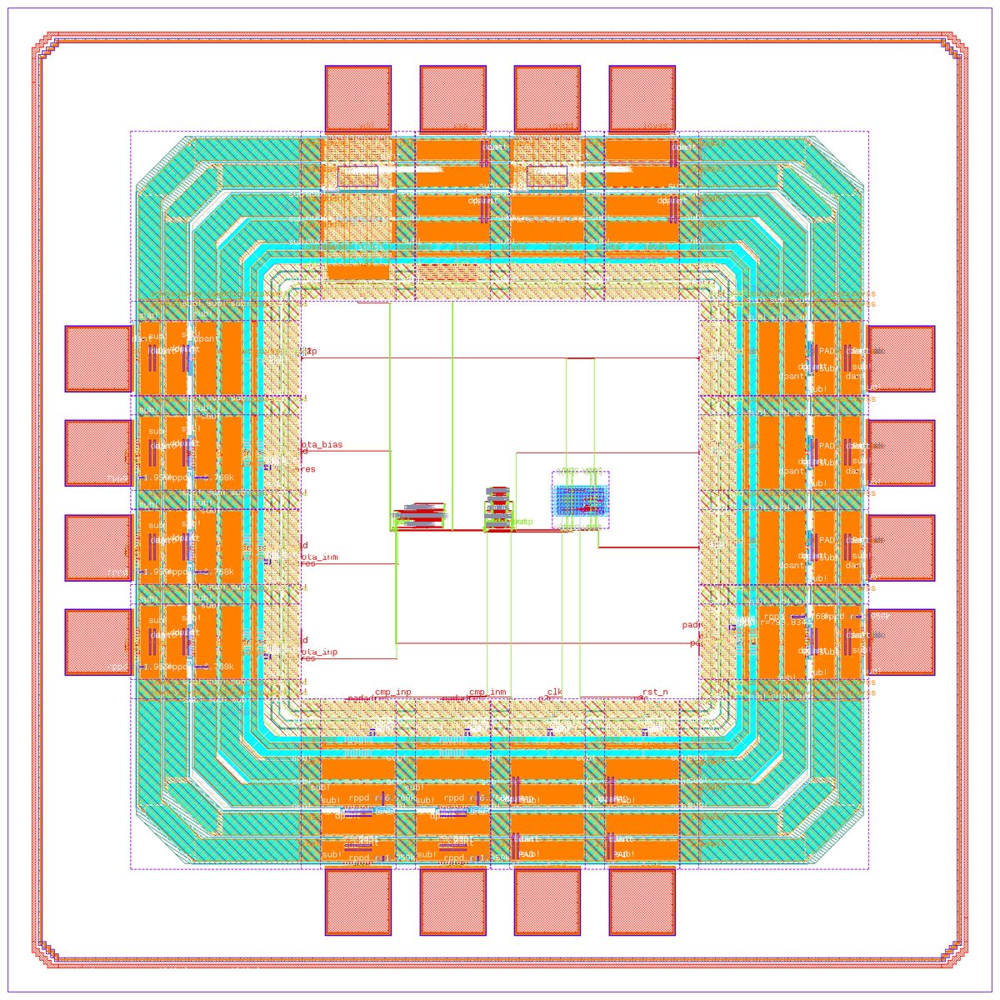

# Analog on top: from templates to a checked chip on IHP SG13G2

This example builds a 1.04 x 1.04 mm chip on IHP SG13G2 and checks it with IHP's own DRC and LVS decks. The core holds three blocks inside a ring of 16 pads from IHP's `sg13g2_io` library:

- **ota:** a five-transistor OTA, from aispice's `ota5t` template.
- **cmp:** a StrongARM comparator, from the `comparator` template.
- **cnt:** a two-bit counter hardened by LibreLane.

The comparator's `outp` enables the counter, so the counter counts its decisions. aispice takes each analog block through the same steps:

1. Start it from the template.
2. Check it at every process corner and temperature.
3. Lay it out with a generator.
4. Check it with DRC and LVS.
5. Extract it, and measure its specs after layout.
6. Export it as a `macro/v1` package.

The counter arrives as a package too. aispice assembles the chip and runs full-chip DRC and LVS.

Every figure below is from one run on 13 Oct 2026:

- aispice `master` at `5db63e1`;
- IHP-Open-PDK at `22f2a25`;
- ngspice 42, KLayout 0.30.7 and Magic 8.3.624 on Linux;
- the counter hardened with LibreLane 3.0.0.dev44.

<p align="center">
  
  <br><sub>The chip from its GDS before fill, drawn with <code>aispice layout render</code>.</sub>
</p>

[ChipLeap's digital-on-top demo](https://github.com/danieltyukov/chipleap/blob/main/docs/demo-digital-on-top.md) is the other way round: a UART chip with an aispice comparator in its core.

## What you need

- A git checkout of IHP-Open-PDK with its OSDI models compiled, the pcell submodules and the IO library (`libs.ref/sg13g2_io`). See [docs/SETUP.md](../../docs/SETUP.md#pdks-for-ic-design).
- ngspice 42 or newer, KLayout and Magic. `aispice doctor` lists them.
- For the counter: LibreLane (the `librelane` command) and Python 3.

Register the PDK once:

```sh
aispice pdk add ihp-sg13g2 ~/IHP-Open-PDK/ihp-sg13g2
cd examples/analog_on_top          # aispice.toml says pdk = "ihp-sg13g2"
```

## 1. The blocks from templates

`ota.asc` and `comparator.asc` are the `ota5t` and `comparator` templates. Their spec tables are beside them, in `ota.specs` and `comparator.specs`. The `templates` tool copies a template into a project. Over MCP the call is:

```json
{"name": "templates", "arguments": {"action": "use", "id": "ota5t", "circuit": "ota.asc"}}
{"name": "templates", "arguments": {"action": "use", "id": "comparator", "circuit": "comparator.asc"}}
```

In `aispice chat` you can ask for the same thing: *"Start a five-transistor OTA from the ota5t template as ota.asc, and a StrongARM comparator from the comparator template as comparator.asc"*.

The templates are sized to meet their tables at every corner of their set. Check that here:

```sh
aispice check ota.asc --process tt,ss,ff,sf,fs --temp=-40,27,125
aispice check comparator.asc --process tt,ss,ff,sf,fs --temp=-40,27,125
```

| Block | Spec | Worst of 15 corners | Typical (tt, 27 C) |
|---|---|---|---|
| OTA, into 1 pF | gain ≥ 24 dB | 25.86 dB (fs, 125 C) | 27.57 dB |
| | unity-gain frequency ≥ 15 MHz | 16.94 MHz (ss, 125 C) | 22.76 MHz |
| | phase margin ≥ 70° | 83.37° (ff, -40 C) | 84.49° |
| Comparator, 1 mV inputs that swap, 500 MHz | both decisions, full reset | pass at every corner | pass |
| | outn through half the supply ≤ 250 ps | 154.6 ps (sf, -40 C) | 107.5 ps |

To resize a block for other specs, edit its `.specs` file and ask the agent to size it with the `optimize` tool at the same corners.

## 2. Layout, DRC and LVS

```sh
aispice layout generate ota.asc --template ota5t
aispice layout generate comparator.asc --template comparator
```

Each generator draws the block with IHP's own pcells. It splits devices into two-finger units, adds dummies and guard rings, and routes on Metal3 tracks and Metal4 columns. Then it runs IHP's DRC and LVS decks:

| Block | Size | Rows (units, `d` a dummy) | DRC | LVS |
|---|---|---|---|---|
| OTA | 49.02 x 25.77 um | tail `d M5 M6 M6 M5 d`, pair `d M1 M2 M1 M2 M2 M1 M2 M1 d`, load `d M3 M4 M4 M3 d` | clean | clean |
| Comparator | 20.28 x 42.70 um | tail `d M0 M0 M0 M0 d`, pair `d M1 M1 M1 M1 M2 M2 M2 M2 d`, latch `M3 \| M4` and `d M5 M6 d`, reset `d M9 M7 M8 M10 d` | clean | clean |

The comparator is drawn mirror-symmetric about its axis. Each device of a pair sits on its own side, and the pair's nets are wired as mirror images. After extraction its outputs carry 27.42 and 27.46 fF, and the input-referred offset of the laid-out latch is under 0.2 mV at tt and 27 C.

## 3. After layout

```sh
aispice check ota.asc --post-layout ota.gds --process tt,ss,ff,sf,fs --temp=-40,27,125
aispice check comparator.asc --post-layout comparator.gds --specs comparator.layout.specs \
    --process tt,ss,ff,sf,fs --temp=-40,27,125
```

Magic extracts the layout with IHP's tech file. The extracted block then replaces the schematic's devices, and every spec runs again at every corner:

| Block | Spec | Before layout, worst | After layout, worst |
|---|---|---|---|
| OTA | gain | 25.86 dB | 26.27 dB |
| | unity-gain frequency | 16.94 MHz | 16.09 MHz |
| | phase margin | 83.37° | 82.02° |
| Comparator | first and second decision | 1.2 V, -1.2 V | 1.198 V, -1.195 V (ss, -40 C) |
| | decision time | 154.6 ps | 334 ps (ss, -40 C) |

The comparator's wiring puts about 27 fF on each output, against the bench's 5 fF loads, so it decides more slowly. Its template therefore gives a separate table for after layout, `comparator.layout.specs`, which allows 375 ps; everything else is unchanged. `templates` (action `show`) prints that table and the reason.

## 4. Macro packages

```sh
aispice macro export ota.asc --layout ota.gds --name ota5t --process tt,ss,ff
aispice macro export comparator.asc --layout comparator.gds --name strongarm \
    --specs comparator.layout.specs --process tt,ss,ff \
    --pins '{"clk": {"kind": "clock"}, "outp": {"kind": "signal"}, "outn": {"kind": "signal"}}'
```

Export works in three stages:

1. It draws the block again with every pin on a Metal4 column at its bottom edge.
2. It checks the new layout with DRC and LVS, extracts it, and measures the specs before and after layout at each corner.
3. It writes `macros/<name>.macro`: `macro.toml` with GDS, LEF, liberty, a Verilog model, the LVS and extracted netlists, the spec table, and DRC, LVS, extraction and simulation evidence.

A package is written only when every spec holds after layout.

| Package | Size | Extracted | Specs after layout, at tt, ss and ff |
|---|---|---|---|
| `ota5t` | 56.19 x 26.37 um | 117.6 fF | gain 27.92 dB, unity-gain 20.59 MHz, phase margin 82.95° (worst) |
| `strongarm` | 32.70 x 43.30 um | 131.4 fF | both decisions; decision time 288.5 ps (worst) |

The counter is hardened by LibreLane with [the script aispice's chip test uses](../../crates/aispice-tools/tests/support/harden_counter.py):

```sh
python3 ../../crates/aispice-tools/tests/support/harden_counter.py build/counter
cp -r build/counter/tiny_counter.macro macros/
```

LibreLane builds a 60 x 60 um block in about 100 s. It is DRC clean on KLayout and Magic, LVS and antenna clean, with 15.1 ns of setup slack at its 50 MHz clock. The package keeps the PDK's standard cells under their own names in its GDS.

## 5. Both tools check every package

aispice and ChipLeap check a package with the same rules. Given the PDK's libraries, each also confirms that every cell a package names like a PDK cell is the PDK's own, byte for byte:

```sh
for p in ota5t strongarm tiny_counter; do
  aispice macro check macros/$p.macro --pdk ihp-sg13g2@22f2a25 --pdk-libs ~/IHP-Open-PDK/ihp-sg13g2
  chipleap macro check macros/$p.macro --pdk ihp-sg13g2@22f2a25 --pdk-libs ~/IHP-Open-PDK/ihp-sg13g2
done
```

| Package | aispice | ChipLeap (`main` at `3183e23`) |
|---|---|---|
| `ota5t` | pass, 0 errors, 0 warnings | pass, 0 errors, 0 warnings |
| `strongarm` | pass, 0 errors, 0 warnings | pass, 0 errors, 0 warnings |
| `tiny_counter` | pass, 0 errors, 1 warning | pass, 0 errors, 1 warning |
| ChipLeap's UART [`strongarm.macro`](https://github.com/danieltyukov/chipleap/tree/main/examples/uart/macros), exported by this aispice from its own netlist | pass, 0 errors, 0 warnings | pass, 0 errors, 0 warnings |

**The counter's warning.** The counter's warning is `pdk.expected`: it was built on PDK commit `cb7daaa`, not the `22f2a25` this chip uses. LibreLane 3.0.0.dev44 hardens on the IHP release it downloads itself (`cb7daaa`), because it cannot load the LibreLane configuration of the `22f2a25` checkout. The twelve standard cells in the counter's GDS are identical to `22f2a25`'s, which is why both checks pass with the libraries. Without `--pdk-libs`, both tools refuse the package with one `pdk.cell_name` error per cell, because they cannot show that those cells are the PDK's own.

## 6. The chip

[`analog_on_top.chip.toml`](analog_on_top.chip.toml) names the three packages, how their pins join chip nets, and the 16 pads.

```sh
aispice chip plan analog_on_top.chip.toml        # floorplan and routes, nothing written
aispice chip assemble analog_on_top.chip.toml    # draw, fill and check the chip
```

```text
analog_on_top: die 1040 x 1040 um, core 420 x 420 um, 16 pads, 40 IO ring cells, 3 blocks.
  block ota (ota5t) at (96.0, 180.2) um in the core, 56.2 x 26.4 um
  block cmp (strongarm) at (192.7, 180.2) um in the core, 32.7 x 43.3 um
  block cnt (tiny_counter) at (265.4, 180.2) um in the core, 60.0 x 60.0 um
  net clk: pad clk (sg13g2_IOPadIn), cmp.clk, cnt.clk (270.0 um, 3 vias)
  net cmp_outp: pad cmp_outp (sg13g2_IOPadOut4mA), cmp.outp, cnt.en (215.4 um, 3 vias)
  ...
Drawn and filled in 60 s.
Checked in 116 s.
DRC clean: cell analog_on_top, decks main, extra, antenna, density.
LVS clean: the layout of analog_on_top matches the schematic.
```

The chip has 16 pads in a ring of IHP's IO cells, with bond pads and IHP's seal ring. The router joins the pads and the blocks' pins on Metal3 and Metal4 (14 nets). The chip is filled to IHP's density rules. IHP's DRC decks (main, extra, antenna and density) run on the whole die. Its LVS deck compares the chip without its pad cells against a netlist made from the packages, down to the counter's standard cells. The chip is `analog_on_top.chip/analog_on_top.gds`.

The picture above is drawn from the chip before fill. `assemble` keeps `chip_nofill.gds` in its run folder under `.aispice/layout/`, which the output names. Copy it into the example, then render it:

```sh
aispice layout render chip_nofill.gds -o chip.png --width 1600 --height 1600
```

## Reproduce it

```sh
aispice pdk add ihp-sg13g2 ~/IHP-Open-PDK/ihp-sg13g2
cd examples/analog_on_top
aispice check ota.asc --process tt,ss,ff,sf,fs --temp=-40,27,125
aispice check comparator.asc --process tt,ss,ff,sf,fs --temp=-40,27,125
aispice layout generate ota.asc --template ota5t
aispice layout generate comparator.asc --template comparator
aispice check ota.asc --post-layout ota.gds --process tt,ss,ff,sf,fs --temp=-40,27,125
aispice check comparator.asc --post-layout comparator.gds --specs comparator.layout.specs --process tt,ss,ff,sf,fs --temp=-40,27,125
aispice macro export ota.asc --layout ota.gds --name ota5t --process tt,ss,ff
aispice macro export comparator.asc --layout comparator.gds --name strongarm --specs comparator.layout.specs --process tt,ss,ff --pins '{"clk": {"kind": "clock"}, "outp": {"kind": "signal"}, "outn": {"kind": "signal"}}'
python3 ../../crates/aispice-tools/tests/support/harden_counter.py build/counter && cp -r build/counter/tiny_counter.macro macros/
aispice macro check macros/tiny_counter.macro --pdk ihp-sg13g2@22f2a25 --pdk-libs ~/IHP-Open-PDK/ihp-sg13g2
aispice chip assemble analog_on_top.chip.toml
```

Generated files (GDS, packages, the chip) are not committed: they hold the PDK's cells, and every step writes them again. The gated test [`chip_ihp`](../../crates/aispice-tools/tests/chip_ihp.rs) builds the same kind of chip from netlists of its own.
